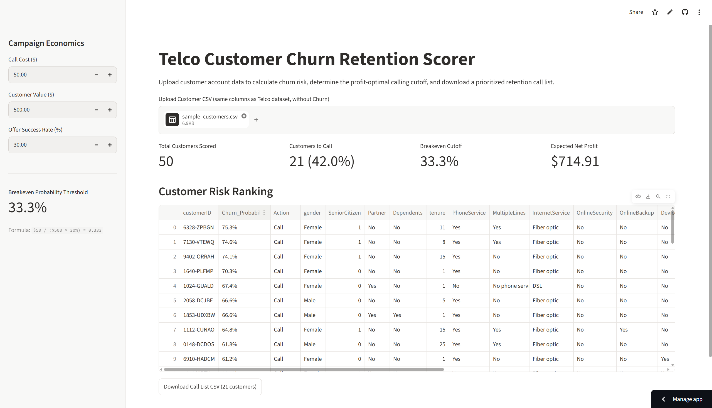

 # Telco Customer Churn Analysis
# Telco Customer Churn Analysis

**Live App:** [Telco Churn Retention Scorer](https://churn-prediction-8gk9gjan4nvxvhgh5jxnmj.streamlit.app/)



## How to run locally

1. **Install dependencies:**
   ```bash
   pip install -r requirements.txt
   ```
2. **Train and save the model:**
   ```bash
   python -m src.train
   ```
3. **Launch the Streamlit app:**
   ```bash
   streamlit run app.py
   ```
4. **Run unit tests:**
   ```bash
   python -m pytest
   ```


## Business Problem
Customer churn directly impacts recurring revenue and increases customer acquisition costs for telecommunications providers. The objective of this project is to identify the primary demographic, account, billing, and service factors driving customer cancellations and build a predictive churn-scoring model so the business can deploy targeted retention strategies and reduce overall churn.

## Data
- **Source:** Telco Customer Churn dataset (`7,043` customer records across `21` features).
- **Target Variable:** `Churn` (binary indicator showing whether a customer left within the last month: `Yes` or `No`).
- **Key Features Analyzed:**
  - **Account & Contract:** `tenure` (months with the company), `Contract`, `PaperlessBilling`, `PaymentMethod`, `MonthlyCharges`, and `TotalCharges`.
  - **Services:** `InternetService` (`DSL`, `Fiber optic`, `No`) and add-on subscriptions.
  - **Demographics:** `gender`, `SeniorCitizen`, `Partner`, and `Dependents`.
- **Data Cleaning & Imputation:**
  - Converted `TotalCharges` from string format to `float64`.
  - Missing values in `TotalCharges` (found exclusively among brand-new customers with `tenure == 0`) were imputed using `MonthlyCharges × tenure` (resulting in `$0.00` for customers who have not yet completed their first billing cycle).

## Key Findings

**Overall Churn Rate:** **26.5%** (`1,869` churned out of `7,043` total customers).

### 1. Month-to-Month Contracts Drive the Vast Majority of Cancellations
- **Flexible contracts carry extreme churn risk.** Customers on **Month-to-month** agreements churn at **42.7%** (`n = 3,875`), which is nearly **4x higher** than One-year contracts at **11.3%** (`n = 1,473`) and **15x higher** than Two-year contracts at **2.8%** (`n = 1,695`).
- **Hypothesis:** Without annual commitment or early-termination friction, month-to-month subscribers treat the service as easily replaceable whenever they encounter price increases, billing friction, or competitor promotions.

### 2. The First Year Is the Critical Danger Zone (Tenure)
- **Nearly half of new customers leave within their first year.** Customers in the **0–12 month** bracket churn at **47.4%** (`n = 2,186`), making onboarding and early engagement the highest-leverage retention opportunity.
- **Retention strengthens dramatically over time.** Once a customer passes the 1-year mark, churn drops sharply to **28.7%** (`13–24m`, `n = 1,024`), **21.6%** (`25–36m`, `n = 832`), **19.0%** (`37–48m`, `n = 762`), **14.4%** (`49–60m`, `n = 832`), and down to **6.6%** for customers staying beyond 5 years (`61–72m`, `n = 1,407`).
- **Hypothesis:** Early churn reflects unmet expectations during onboarding and initial billing cycles, whereas customers who survive the first year have integrated the service into their household routine and are likely locked into multi-year contracts.

### 3. Electronic Check Churn Is Driven by Both Contract Overlap and Payment Friction
- **Electronic check users churn nearly 3x more than auto-pay customers.** Overall, **Electronic check** users churn at **45.3%** (`n = 2,365`), compared to **19.1%** for Mailed check (`n = 1,612`), **16.7%** for Bank transfer (`n = 1,544`), and **15.2%** for Credit card (`n = 1,522`).
- **Cross-tabulation reveals heavy overlap with Month-to-month contracts—but a persistent gap within every tier:**
  - **78.2%** of all Electronic check users (`1,850` of `2,365`) are on **Month-to-month** plans, where their churn reaches **53.7%** (`n = 1,850`)—far above Month-to-month customers using Bank transfer (**34.1%**, `n = 589`), Credit card (**32.8%**, `n = 543`), or Mailed check (**31.6%**, `n = 893`).
  - Even on **One-year** (`18.4%`, `n = 347` vs. `6.8%–10.3%` for other methods) and **Two-year** contracts (`7.7%`, `n = 168` vs. `0.8%–3.4%`), Electronic check users still churn at roughly double the rate of other payment methods.
- **Hypothesis:** High churn among Electronic check users is a two-part effect: (1) heavy concentration in flexible Month-to-month contracts, and (2) active monthly billing friction—unlike automatic payments that run silently in the background, manual electronic checks force customers to actively review and approve their bill every month, creating a recurring decision point to cancel.

### 4. Fiber Optic Customers Churn at More Than Double the Rate of DSL
- **Fiber optic internet is the highest-risk product segment.** Fiber optic subscribers churn at **41.9%** (`n = 3,096`), compared to **19.0%** for DSL (`n = 2,421`) and **7.4%** for customers without internet service (`n = 1,526`).
- **Hypothesis:** Elevated churn among Fiber optic users likely stems from higher monthly price sensitivity (`MonthlyCharges`), higher expectations for speed/reliability, or heavy overlap with Month-to-month and Electronic check cohorts rather than dissatisfaction with fiber technology itself.

### 5. Paperless Billing and Single-Member Households Show Higher Churn
- **Paperless billing shows elevated churn.** Customers using paperless billing churn at **33.6%** (`n = 4,171`), more than double the **16.3%** churn rate of traditional paper billing (`n = 2,872`).
- **Single-member households leave more frequently.** Customers without a partner churn at **33.0%** (`n = 3,641`) vs. **19.7%** with a partner (`n = 3,402`), and customers without dependents churn at **31.3%** (`n = 4,933`) vs. **15.5%** with dependents (`n = 2,110`).
- **Hypothesis:** Paperless billing likely acts as a proxy for digital-first Month-to-month/Electronic check segments, while single-member households face lower switching costs because fewer people rely on the home connection.

## Deep-Dive: Why Do Electronic-Check Users Churn More & How to Test It?

### Why Electronic-Check Users Churn More
1. **Contract Self-Selection (Proven in Cross-Tab Check):** Nearly 4 out of 5 Electronic check users (`1,850` of `2,365`) choose Month-to-month contracts, meaning they self-select into maximum flexibility and low commitment from day one.
2. **Active Billing Friction ("The Monthly Reminder Effect"):** Automatic credit card and bank transfers happen passively, whereas paying by electronic check requires manual action each month. Every manual payment forces the customer to notice the exact dollar amount leaving their account—triggering price sensitivity and cancellation decisions.
3. **Price & Service Tier Overlap (To Be Tested):** Electronic check users may disproportionately subscribe to expensive **Fiber optic** plans (`MonthlyCharges`) without retention-anchoring add-ons like `TechSupport` or `OnlineSecurity`, amplifying sticker shock every billing cycle.

### How to Test the Remaining Hypotheses
- **Check 1 — Price & Service Tier Overlap (`InternetService` × `PaymentMethod` × `MonthlyCharges`):** Cross-tabulate `PaymentMethod` against `InternetService` and compare median `MonthlyCharges` across payment methods to test whether Electronic check users pay higher monthly bills than auto-pay customers.
- **Check 2 — Add-On Retention Anchors (`TechSupport` & `OnlineSecurity`):** Within the `Month-to-month + Electronic check` cohort (`n = 1,850`), compare churn rates between customers with `TechSupport == "Yes"` vs. `"No"` and `OnlineSecurity == "Yes"` vs. `"No"`.
- **Check 3 — Tenure Distribution by Payment Method:** Compare median `tenure` across the four `PaymentMethod` groups to verify whether Electronic check users skew heavily toward brand-new customers (`0–12m`).

## Modeling & Validation Results

### Methodology
- **Train/Test Split:** Stratified 80/20 split (`5,634` train / `1,409` test records, `random_state=42`) to preserve the exact **26.5%** churn distribution across both sets.
- **Leak-Proof Preprocessing (`ColumnTransformer`):**
  - Numeric features (`tenure`, `MonthlyCharges`, `TotalCharges`, `SeniorCitizen`) imputed with median and standardized via `StandardScaler`.
  - Categorical features imputed with most frequent category and encoded via `OneHotEncoder(handle_unknown="ignore", sparse_output=False)`.


### Model Comparison Results

| Model | 5-Fold CV ROC AUC (Mean ± Std) | Min / Max Fold AUC | Hold-Out Test ROC AUC | Hold-Out Test Precision @ Top 20% |
| :--- | :---: | :---: | :---: | :---: |
| **Logistic Regression** *(Winner)* | **`0.8462 ± 0.0126`** | `0.8252` / `0.8630` | **`0.8421`** | **`66.2%` (`0.6619`)** |
| **HistGradientBoosting** | `0.8364 ± 0.0054` | `0.8261` / `0.8420` | — *(Not selected)* | — |
| **Dummy Classifier** (`most_frequent`) | `0.5000 ± 0.0000` | `0.5000` / `0.5000` | — *(Not selected)* | — |

- **Model Choice & Stability:** **Logistic Regression** edged out default `HistGradientBoosting` in 5-fold cross-validation (`0.8462` vs. `0.8364`), offering a strong balance of ranking accuracy, interpretability, and simplicity for tabular data of this size (though tuned gradient boosting could potentially close that gap). Performance remained highly stable across validation folds (`0.825–0.863`) and generalized cleanly to the hold-out test set (**test ROC AUC `0.842` ≈ CV `0.846`**), achieving **66.2% Precision @ Top 20%** (`186` actual churners captured out of `281` flagged customers—a **2.35x lift** over untargeted outreach).

## Data leakage safeguards
- **What leakage is:** Data leakage occurs when information from outside the training dataset (such as validation/test statistics or future post-outcome data) is inadvertently used to train or preprocess a model, creating overly optimistic evaluation metrics that fail in production.
- **How this project prevents it:** All preprocessing (`SimpleImputer`, `StandardScaler`, and `OneHotEncoder`) is encapsulated inside a Scikit-Learn `ColumnTransformer` and `Pipeline` fitted strictly on training folds during 5-fold cross-validation (`X_train`), while the hold-out test set (`X_test`) remains completely untouched until a single final evaluation of the winning model.
- **Known limitation:** Because this dataset is a static single-point-in-time snapshot without feature timestamps, we cannot verify exact temporal ordering (e.g., whether a customer switched to `Month-to-month` or `PaperlessBilling` shortly before churning rather than months prior), which could introduce subtle target-proxy leakage in a live production deployment.

## Model Explainability: Top Churn & Retention Drivers

Extracting the learned log-odds coefficients from the fitted `LogisticRegression` pipeline confirms our core EDA drivers while highlighting important nuances in how correlated billing and service features behave together:

### Top Risk-Increasing vs. Retention-Driving Features

| Direction | Feature | Coefficient (Log-Odds) | Odds Ratio |
| :--- | :--- | :---: | :---: |
| **Pushes Risk UP** | `InternetService_Fiber optic` | `+0.6342` | `1.89x` |
| **Pushes Risk UP** | `Contract_Month-to-month` | `+0.5829` | `1.79x` |
| **Pushes Risk UP** | `TotalCharges` | `+0.5363` | `1.71x` |
| **Pushes Risk UP** | `StreamingMovies_Yes` / `StreamingTV_Yes` | `+0.2009` / `+0.2005` | `1.22x` |
| **Pushes Risk UP** | `PaymentMethod_Electronic check` | `+0.1979` | `1.22x` |
| **Pushes Risk UP** | `OnlineSecurity_No` / `TechSupport_No` | `+0.1563` / `+0.1315` | `1.17x` / `1.14x` |
| **Pushes Risk DOWN** | `tenure` | `-1.2575` | `0.28x` |
| **Pushes Risk DOWN** | `Contract_Two year` | `-0.7766` | `0.46x` |
| **Pushes Risk DOWN** | `InternetService_DSL` | `-0.6486` | `0.52x` |
| **Pushes Risk DOWN** | `MonthlyCharges` | `-0.5919` | `0.55x` |
| **Pushes Risk DOWN** | `PaperlessBilling_No` | `-0.3432` | `0.71x` |
| **Pushes Risk DOWN** | `No internet service` *(7 identical columns)* | `-0.3001` | `0.74x` |

### Key Takeaways & Interpretation Caveats
- **Alignment with EDA Findings:** As expected, **Fiber optic internet** (`+0.634`), **Month-to-month contracts** (`+0.583`), **Electronic check payments** (`+0.198`), and **missing security/tech support** (`+0.156` / `+0.132`) are the primary drivers pushing churn risk upward, while **longer tenure** (`-1.258`), **Two-year contracts** (`-0.777`), and **DSL service** (`-0.649`) are the strongest retention anchors.
- **Caveat 1 — Correlated Billing Columns (`tenure`, `MonthlyCharges`, and `TotalCharges`):** Tenure, monthly bill, and total amount paid are closely linked because `TotalCharges` is roughly `tenure × MonthlyCharges`. As a result, the model splits their combined effect across all three features (`MonthlyCharges` appears negative at `-0.592` while `TotalCharges` is positive at `+0.536`). **What to act on:** Longer-staying customers are much less likely to leave—do not read the individual bill coefficients as *"higher monthly bills keep customers."*
- **Caveat 2 — Streaming Add-Ons (`StreamingTV_Yes` / `StreamingMovies_Yes`):** In raw EDA, streaming subscribers do not look unusually risky because they tend to have longer tenure and more bundled add-ons, which masks churn risk. Once the model compares streamers against otherwise similar customers (same tenure, contract, and internet tier), a modest positive churn risk (`+0.201`) emerges—a hypothesis that can be verified by comparing median tenure for `StreamingTV == "Yes"` vs. `"No"`.
- **Caveat 3 — Duplicated `"No internet service"` Columns:** One-hot encoding creates identical `0/1` indicator columns across `InternetService_No` and all six internet add-on columns (`OnlineSecurity`, `OnlineBackup`, `DeviceProtection`, `TechSupport`, `StreamingTV`, `StreamingMovies`), causing L2 regularization to split the exact same retention effect equally (`-0.3001` each) across all seven duplicated indicators.

## Recommended Action Items
- **Score & Target the Top 20% Highest-Risk Customers:** Deploy the Logistic Regression risk score monthly to prioritize retention outreach toward the top 20% highest-probability churners (`66.2%` precision) rather than running untargeted campaigns.
- **Bundle Auto-Pay + Contract Upgrades for Electronic Check Users:** Target the **1,850 Month-to-month Electronic check customers** (`53.7%` churn) with a combined incentive—such as a `$5/month` bill credit or waived fee—when they enroll in automatic payments alongside a 1-year contract.
- **Launch a First-Year Onboarding Program:** Target new customers in months **0–12** (`47.4%` churn) with proactive check-ins and loyalty milestones to guide them past the critical first-year drop-off window.
- **Audit the Fiber Optic Experience & Pricing:** Investigate pricing sensitivity, technical support usage, and add-on adoption specifically among **Fiber optic** subscribers (`41.9%` churn).
- **Promote Family & Multi-User Bundles:** Market multi-line or household value packs to single customers without partners or dependents to increase switching costs and account stickiness.

## Reproducibility Note
Before committing updates to the repository, ensure clean execution order in Jupyter Notebook via **Kernel → Restart & Run All** so all cell outputs and metrics execute sequentially from top to bottom.

## Who should we call, and why

### 1. What Makes a Customer High-Risk? (Top Model Drivers)
Our Logistic Regression model scores every customer's churn risk based on their account profile:
- **Primary Churn Triggers (Push Risk UP):** Customers on **Month-to-month contracts** (`1.79x` odds), **Fiber optic internet** (`1.89x` odds), **Electronic check payments** (`1.22x` odds), and those lacking **Online Security** (`1.17x`) or **Tech Support** (`1.14x`) carry the highest cancellation risk.
- **Primary Retention Anchors (Push Risk DOWN):** **Longer tenure** (`0.28x` odds per standard-deviation increase), **Two-year contracts** (`0.46x` odds), and **DSL service** (`0.52x` odds) strongly protect against churn.
- **How to Read Billing & Streaming Features:**
  - *Tenure vs. Monthly/Total Bill:* Because `TotalCharges` is roughly `tenure × MonthlyCharges`, the model splits their combined effect (`MonthlyCharges` appears negative while `TotalCharges` is positive). The takeaway for retention managers is straightforward: **longer-staying customers are much less likely to leave**—do not interpret individual bill coefficients as *"higher monthly bills retain customers."*
  - *Streaming Add-Ons:* In raw data, streaming subscribers look stable because they tend to have longer tenure. Once the model compares streamers against otherwise similar customers (same tenure, contract, and internet tier), a small extra churn risk (`1.22x` odds) appears.

### 2. When Should We Call? (The `0.33` Profit-Optimal Cutoff)
- **Why `0.33` Is the Breakeven Threshold:** Each retention call costs **$50**, and saving a true churner yields **$150** in expected value (`30%` save rate × `$500` customer lifetime value). Calling a customer breaks even when `Churn Probability × $150 = $50`, which equals **`0.333` (`33.3%`)**. Sweeping thresholds on leak-free out-of-fold training predictions confirms that profit peaks at **`0.33`**, outperforming the conservative `0.50` default and `Top 20%` benchmarks on training data.
- **Hold-Out Test Set Business Impact (`n = 1,409` customers, `374` actual churners):**

| Calling Strategy | Customers Called | Real Churners Reached | Recall (% of Churners Caught) | Expected Net Profit ($) |
| :--- | :---: | :---: | :---: | :---: |
| **Optimal Train Threshold (`0.33`)** | `500` | `269` | **`71.9%`** | **`$15,350`** |
| **Default Cutoff (`0.50`)** | `318` | `209` | `55.9%` | **`$15,450`** |
| **Top 20% Highest Risk Only** | `281` | `186` | `49.7%` | `$13,850` |

- **Manager Decision Rule:** Both `0.33` (`$15,350`) and `0.50` (`$15,450`) beat the `Top 20%` cutoff (`$13,850`) by ~$1,500–$1,600 on the test set and deliver virtually identical net profit. **Use `0.33` when maximizing subscriber retention is the goal** (catching `60` more churners—`71.9%` vs. `55.9%`—at break-even incremental cost), or **use `0.50` when call-center bandwidth is constrained** (achieving the same profit with `36%` fewer calls).

### 3. Who Does the Model Miss? (Error Analysis on Training OOF Predictions)
To understand the model's blind spots without leaking test-set information, we analyzed all **`1,495` real churners** in the training set using out-of-fold cross-validation predictions (giving a larger sample of `389` missed churners scored by models that had not seen them):
- **Summary:** At the **`0.33`** threshold, the model **catches `74.0%` of real churners (`1,106` of `1,495`)** and **misses `26.0%` (`389` of `1,495`)**.
- **How Missed Churners (`prob < 0.33`) Differ from Caught Churners (`prob >= 0.33`):**
  - **Contracts:** `98.7%` of caught churners are Month-to-month, whereas **`39.8%` of missed churners are on One-year (`29.8%`) or Two-year (`10.0%`) contracts** (only `60.2%` Month-to-month).
  - **Tenure:** Missed churners have a **median tenure of `37.0` months**—more than **5x longer** than caught churners (**median `7.0` months**).
  - **Payment Method:** Caught churners are heavily concentrated in Electronic check (`68.7%`), while **missed churners are spread evenly—with `46.6%` enrolled in automatic payments** (`22.9%` Bank transfer, `23.7%` Credit card).
  - **Internet & Monthly Bill:** Caught churners are `80.5%` Fiber optic with a higher median bill (`$81.12`), whereas **missed churners include `37.8%` DSL and `22.4%` No internet**, paying a lower **median bill of `$60.30`**.
  - **Borderline Near-Misses (`prob` `0.308–0.329`):** Inspecting the 30 highest-probability missed churners shows two recurring groups just below the cutoff: (1) **long-tenure Fiber optic subscribers (`25–58` months)** on auto-pay whose loyalty history offsets their high bill, and (2) **new DSL / No-internet customers (`1–9` months)** whose lower monthly bills keep them below `0.33`.
- **Manager Takeaway:** The model misses churners who look like **"safe" customers on paper**—longer tenure, annual contracts, auto-pay, and cheaper plans. Their reasons for leaving (such as recent service outages, unresolved support tickets, relocation, or expiring contract promos) are not captured in this static account dataset.


## Project Structure & How to Run

### Repository Layout
```text
├── app.py                   # Streamlit retention scoring & call-list app
├── data/
│   ├── WA_Fn-UseC_-Telco-Customer-Churn.csv
│   └── sample_customers.csv # 50-row sample CSV (without Churn) for testing the app
├── models/
│   └── churn_model.joblib   # Trained Logistic Regression pipeline artifact
├── notebooks/               # Exploratory analysis, validation, and threshold tuning notebooks
├── src/
│   ├── __init__.py
│   ├── data.py              # Shared clean(df) preprocessing function
│   └── train.py             # Trains pipeline on full dataset and saves churn_model.joblib
├── tests/
│   └── test_data.py         # Unit tests for data cleaning
├── requirements.txt
└── README.md
```

### Setup & Usage (Run from Project Root)
1. **Install dependencies:**
   ```bash
   pip install -r requirements.txt
   ```
2. **Run unit tests:**
   ```bash
   python -m pytest
   ```
3. **Train and save the production model:**
   ```bash
   python -m src.train
   ```
4. **Launch the Streamlit retention app:**
   ```bash
   streamlit run app.py
   ```